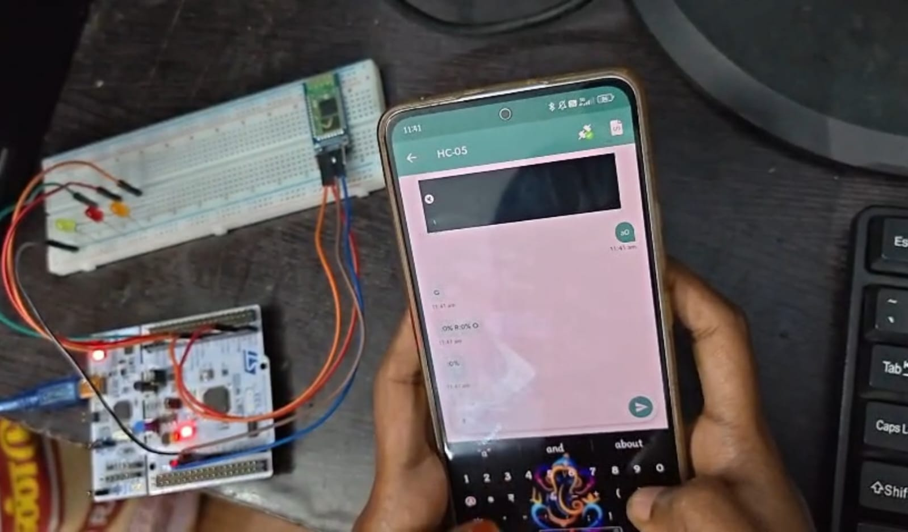
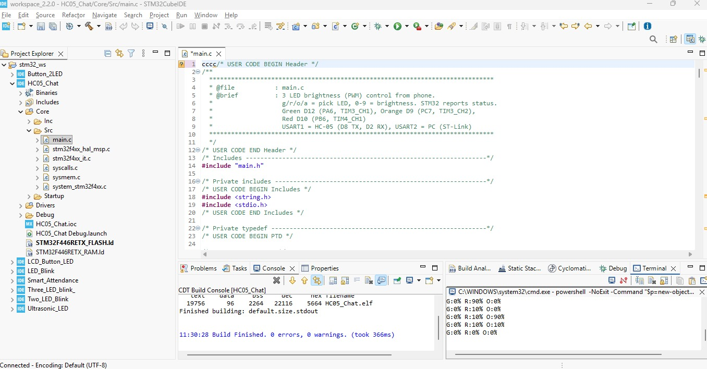

# Bluetooth PWM LED Brightness Control on STM32 NUCLEO-F446RE

Control the brightness of **three LEDs (green, red and orange)** from a phone over **Bluetooth** using an **HC-05** module and **hardware PWM** on an STM32F446RE. Send a letter to pick an LED and a digit to set its brightness. The board replies with the live status of all three LEDs on both the phone and the PC terminal.


-lightgrey)

---

## Project Overview

This project controls the brightness of three LEDs from an Android phone using the **STM32 NUCLEO-F446RE** board and an **HC-05** Bluetooth module.

The phone sends a **letter** to select an LED and a **digit** to set its brightness. The STM32 changes the **PWM duty cycle** of that LED and sends the status of all three LEDs back to the phone and to the PC.

The project was configured with **STM32CubeMX** (STM32 HAL library) and built, flashed and run with **STM32CubeIDE**. The status is shown in a **PowerShell** window through the ST-LINK Virtual COM Port.

## Key Features

- Bluetooth control from an Android phone using an HC-05 module
- Independent brightness control of 3 LEDs (green, red, orange)
- Hardware PWM from TIM3 (2 channels) and TIM4 (1 channel) at 1 kHz
- Simple commands: a letter selects the LED, a digit sets the brightness
- Commands can be chained, for example `g5r9o2`
- Interrupt-driven UART reception with a ring buffer
- Automatic recovery from UART overrun and noise errors
- Live status (`G:70% R:0% O:0%`) sent to the phone and to PowerShell
- UART output at 115200 baud read in PowerShell, no extra terminal software needed
- Programming and debugging through the on-board ST-LINK

## Hardware Required

| Component                                          | Quantity  |
|----------------------------------------------------|-----------|
| STM32 NUCLEO-F446RE board                          | 1         |
| HC-05 Bluetooth module                             | 1         |
| LED, green                                         | 1         |
| LED, red                                           | 1         |
| LED, orange                                        | 1         |
| Current-limiting resistor (220 Ω typical)          | 3         |
| Breadboard                                         | 1         |
| Jumper wires                                       | as needed |
| USB cable (data cable)                             | 1         |
| Android phone with a Bluetooth serial terminal app | 1         |

## Circuit Connections

| Connection                    | NUCLEO-F446RE Pin |
|-------------------------------|-------------------|
| Green LED (through resistor)  | D12 (PA6)         |
| Orange LED (through resistor) | D9 (PC7)          |
| Red LED (through resistor)    | D10 (PB6)         |
| HC-05 VCC                     | 5V                |
| HC-05 GND                     | GND               |
| HC-05 TX                      | D2 (PA10)         |
| HC-05 RX                      | D8 (PA9)          |
| All LED cathodes (short legs) | GND               |

Each LED is connected as: **PWM pin → resistor → LED anode (long leg)**, and **LED cathode (short leg) → GND**.

The HC-05 TX and RX lines are **crossed**: HC-05 TX goes to the STM32 RX pin (D2), and HC-05 RX goes to the STM32 TX pin (D8).

### Project Setup



## System Architecture

```
Phone (Bluetooth serial terminal app)
     ↓ (Bluetooth)
HC-05 Module
     ↓ (UART, 9600 baud)
USART1 (PA9 TX / PA10 RX)
     ↓
STM32F446RE Microcontroller
     ├── TIM3 / TIM4 PWM (PA6, PC7, PB6) → Green, Orange, Red LEDs
     └── USART2 (PA2 TX / PA3 RX) → ST-LINK Virtual COM Port → PC (PowerShell, COM26)
```

## Pin Configuration

| Signal              | MCU Pin | Mode                      |
|---------------------|---------|---------------------------|
| Green LED           | PA6     | TIM3_CH1 (PWM Generation) |
| Orange LED          | PC7     | TIM3_CH2 (PWM Generation) |
| Red LED             | PB6     | TIM4_CH1 (PWM Generation) |
| HC-05 RX (STM32 TX) | PA9     | USART1_TX                 |
| HC-05 TX (STM32 RX) | PA10    | USART1_RX                 |
| UART TX to PC       | PA2     | USART2_TX                 |
| UART RX from PC     | PA3     | USART2_RX                 |

## STM32CubeMX Configuration

1. Create a new project and select the **NUCLEO-F446RE** board in the Board Selector.
2. Initialize all peripherals with their default mode.
3. Enable **TIM3**: Clock Source **Internal Clock**, Channel 1 and Channel 2 set to **PWM Generation**. Check that CH1 is on **PA6** and CH2 is on **PC7** (the default for CH2 is PA7, so change it to PC7).
4. Set TIM3 **Prescaler = 83** and **Counter Period = 999**.
5. Enable **TIM4**: Clock Source **Internal Clock**, Channel 1 set to **PWM Generation** (PB6), with **Prescaler = 83** and **Counter Period = 999**.
6. Enable **USART1** in Asynchronous mode (PA9 as TX, PA10 as RX) with a baud rate of **9600**.
7. In the USART1 **NVIC Settings** tab, tick **USART1 global interrupt**.
8. Check that **USART2** is in Asynchronous mode (PA2 as TX, PA3 as RX) with a baud rate of **115200**.
9. In Project Manager, set the toolchain / IDE to **STM32CubeIDE**.
10. Click **Generate Code**.

## PWM Configuration

| Parameter      | Value                      |
|----------------|----------------------------|
| Timer clock    | 84 MHz                     |
| Prescaler      | 83 (timer counts at 1 MHz) |
| Counter Period | 999 (1000 counts)          |
| PWM frequency  | 1 kHz                      |
| Duty cycle     | `digit × 10 %`             |

The digit sent from the phone is multiplied by 100 and written to the timer compare register (`CCR`), so each step changes the brightness by 10 %.

| Digit | PWM Duty Cycle |
|-------|----------------|
| 0     | 0 % (off)      |
| 1     | 10 %           |
| 3     | 30 %           |
| 5     | 50 %           |
| 7     | 70 %           |
| 9     | 90 %           |

## Command Protocol

A command has two parts: a **letter** that selects the LED and a **digit** that sets its brightness. The selected LED stays selected until another letter is sent, so several digits can be sent in a row.

| Character  | Meaning                                                          |
|------------|------------------------------------------------------------------|
| `g`        | Select the green LED                                             |
| `r`        | Select the red LED                                               |
| `o`        | Select the orange LED                                            |
| `a`        | Select all three LEDs                                            |
| `0` to `9` | Set the brightness of the selected LED(s). `0` = off, `9` = 90 % |

Commands are not case sensitive. Enter and spaces are ignored.

| Example  | Result                            |
|----------|-----------------------------------|
| `g7`     | Green LED at 70 %                 |
| `r3`     | Red LED at 30 %                   |
| `o9`     | Orange LED at 90 %                |
| `a0`     | All LEDs off                      |
| `a9`     | All LEDs at 90 %                  |
| `g5r9o2` | Green 50 %, red 90 %, orange 20 % |

If a digit is sent before any LED is selected, the board replies `Type g, r, o or a first`.

## Working

The program follows these steps:

1. Initialize the GPIO pins, USART1, USART2, TIM3 and TIM4.
2. Start the three PWM channels with 0 % duty, so all LEDs are off.
3. Send `Ready. g/r/o/a then 0-9. Example: g7` to the phone and to the PC.
4. Start interrupt-based reception on USART1 (HC-05).
5. Each received byte is stored in a **ring buffer** by the UART interrupt.
6. The main loop reads the buffer one byte at a time:
   - A letter (`g`, `r`, `o`, `a`) selects the LED.
   - A digit (`0` to `9`) sets the brightness level of the selected LED(s) and updates the PWM duty cycle.
7. After every change, send the status of all three LEDs to the phone and to the PC.

```
Phone command → HC-05 → USART1 interrupt → Ring buffer → Command logic → PWM duty update → Status to phone and PC
```

## Code

The program is written in [`STM32.C`](https://github.com/NandhinidotS/STM32-Bluetooth-PWM-LED-Control/blob/main/STM32.c). The STM32CubeIDE window with the source code and the live terminal output are shown below.

### STM32CubeIDE main.c and Terminal Output



## Serial Output

The ST-LINK on the Nucleo board provides a Virtual COM Port, so no extra USB-to-serial adapter is needed. Check the COM port number in **Device Manager** (this project used **COM26**).

Run this command from the Windows Run dialog (`Win + R`) or Command Prompt to open a PowerShell window that stays open:

```
powershell -NoExit -Command "$p=new-object System.IO.Ports.SerialPort COM26,115200,None,8,one; $p.Open(); while($true){$p.ReadLine()}"
```

If you are already inside a PowerShell window, run only the inner part:

```
$p=new-object System.IO.Ports.SerialPort COM26,115200,None,8,one; $p.Open(); while($true){$p.ReadLine()}
```

| Setting   | Value                           |
|-----------|---------------------------------|
| Port      | COM26 (change to match your PC) |
| Baud rate | 115200                          |
| Data bits | 8                               |
| Parity    | None                            |
| Stop bits | 1                               |

Press `Ctrl + C` to stop reading. Run `$p.Close()` before opening the port again.

## Output

After every command, the board sends the brightness of the **G**reen, **R**ed and **O**range LEDs. The same message appears in the phone terminal app and in the PowerShell window.

Message format:

```
G:<value>% R:<value>% O:<value>%
```

Example output:

```
Ready. g/r/o/a then 0-9. Example: g7
G:0% R:0% O:0%
G:0% R:90% O:0%
G:0% R:10% O:0%
G:0% R:10% O:90%
G:0% R:10% O:10%
G:0% R:0% O:0%
```

## Demo Video

[Watch the project demo video](https://drive.google.com/file/d/1VI2-XGKlymgrYX0LSyzcN0QLbJnKaEaZ/view?usp=drivesdk)

## How to Run

1. Connect the LEDs and the HC-05 to the board as shown in the circuit connections.
2. Connect the board to the PC with a USB cable.
3. Open the project in **STM32CubeIDE** (File → Import → Existing Projects into Workspace).
4. Build the project with **Ctrl + B**.
5. Flash the program with **Run → Run As → STM32 C/C++ Application**.
6. Press the black **Reset** button if the program does not start.
7. On the phone, pair with **HC-05** (PIN `1234` or `0000`).
8. Open a Bluetooth serial terminal app (for example *Serial Bluetooth Terminal*) and connect to HC-05.
9. Open PowerShell and run the serial command above.
10. Send commands such as `g7`, `r3` or `a9` from the phone.

## Testing

| Test                                             | Result     |
|--------------------------------------------------|------------|
| Build in STM32CubeIDE                            | Successful |
| Flash through ST-LINK                            | Successful |
| HC-05 pairing and connection from the phone      | Working    |
| Letter and digit commands                        | Working    |
| Brightness control of green, red and orange LEDs | Working    |
| Chained commands (`g5r9o2`)                      | Working    |
| Status feedback on phone and in PowerShell       | Working    |

## Important Notes

### Jumpers

Both **CN2** jumper caps on the board must be fitted. If they are missing, the programmer cannot connect to the chip.

### HC-05 Wiring

The HC-05 TX must go to the STM32 RX pin (D2) and the HC-05 RX must go to the STM32 TX pin (D8). If they are not crossed, the board will not respond. When the phone is connected, the HC-05 LED blinks twice every 2 seconds. Fast blinking means it is waiting for a connection.

### Android Only

The HC-05 uses classic Bluetooth, which iOS does not support for serial terminal apps. Use an Android phone.

### Maximum Brightness

The digit `9` gives 90 % duty cycle, so 100 % brightness is not reachable with a single digit.

### Regenerating Code in CubeMX

If you regenerate the code, check that TIM3 CH2 is still on **PC7**, that the **USART1 global interrupt** is still enabled, and that your own code is still inside the `USER CODE BEGIN` and `USER CODE END` blocks.

### COM Port

The COM port number can change between PCs or USB ports. Always check Device Manager before running the PowerShell command. Only one program can use the COM port at a time, so close any other serial terminal first.

### USB Cable

Use a data-capable USB cable. Some cables only charge.

## Technologies and Concepts

- STM32 NUCLEO-F446RE
- STM32CubeMX
- STM32CubeIDE
- STM32 HAL library
- PWM generation with TIM3 and TIM4
- UART communication (USART1 and USART2)
- Interrupt-driven UART reception with a ring buffer
- HC-05 Bluetooth module
- ST-LINK Virtual COM Port
- PowerShell serial reading

## Future Improvements

- Reach 100 % brightness (add a command for full brightness)
- Smooth fade in and fade out effects
- Multi-digit brightness values such as `g75`
- Custom Android app with sliders instead of a serial terminal
- Control an RGB LED
- Add voice control from the phone
